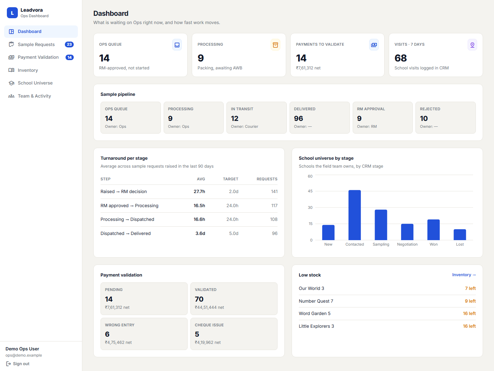
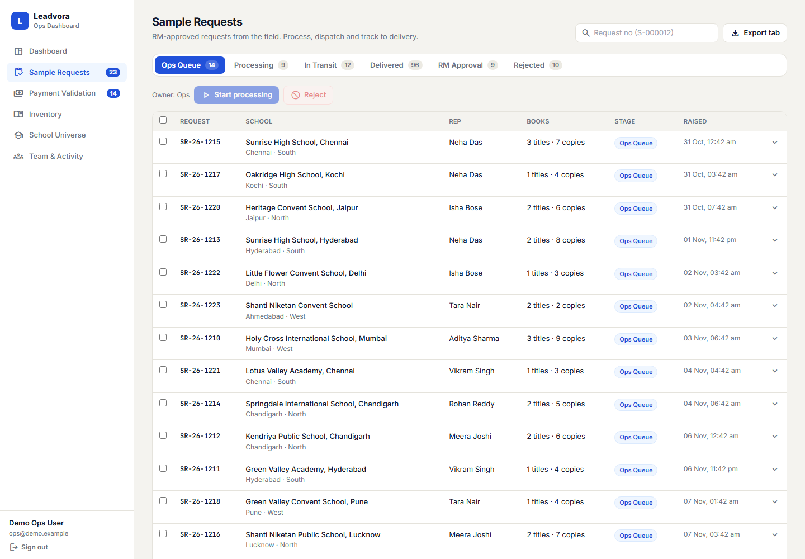
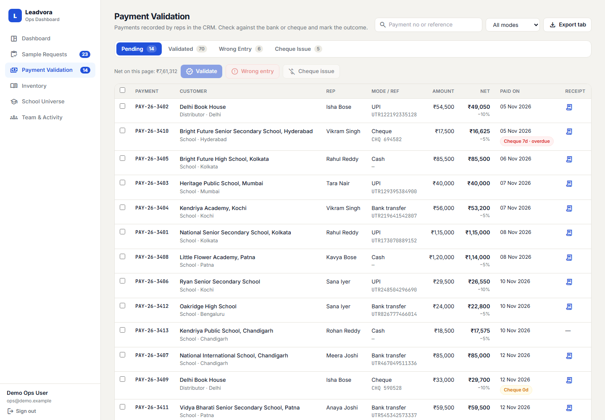
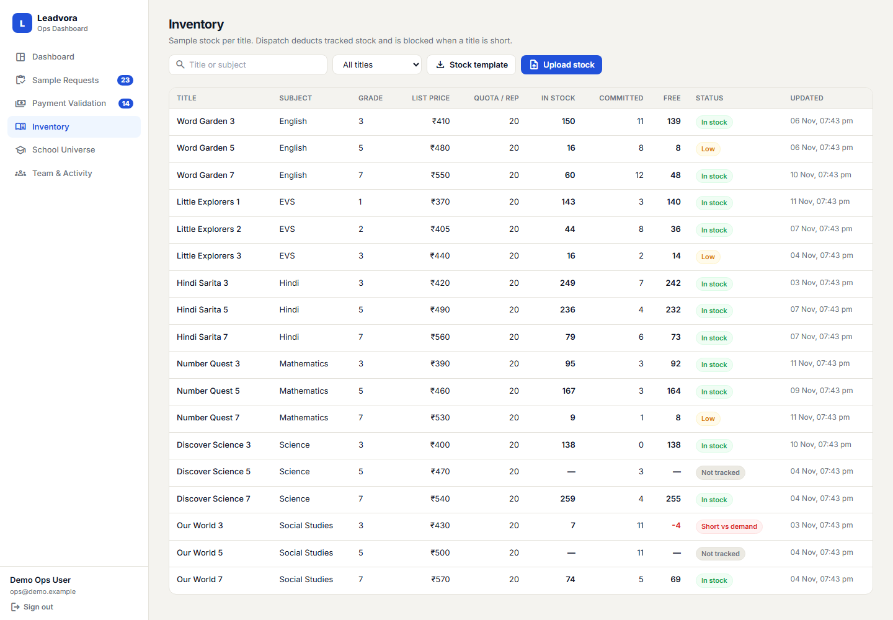
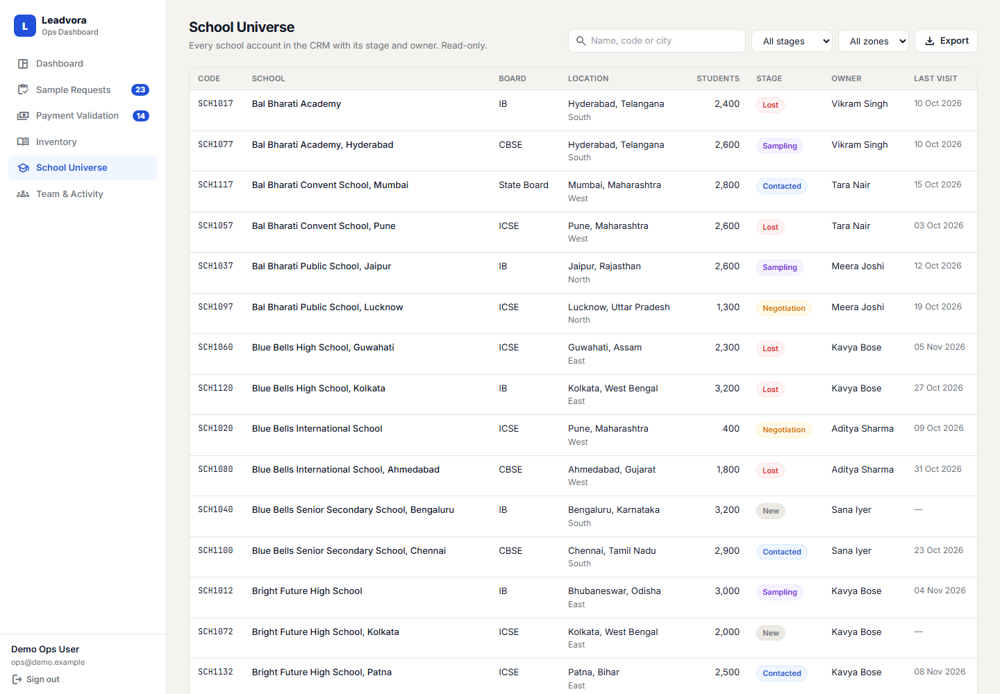
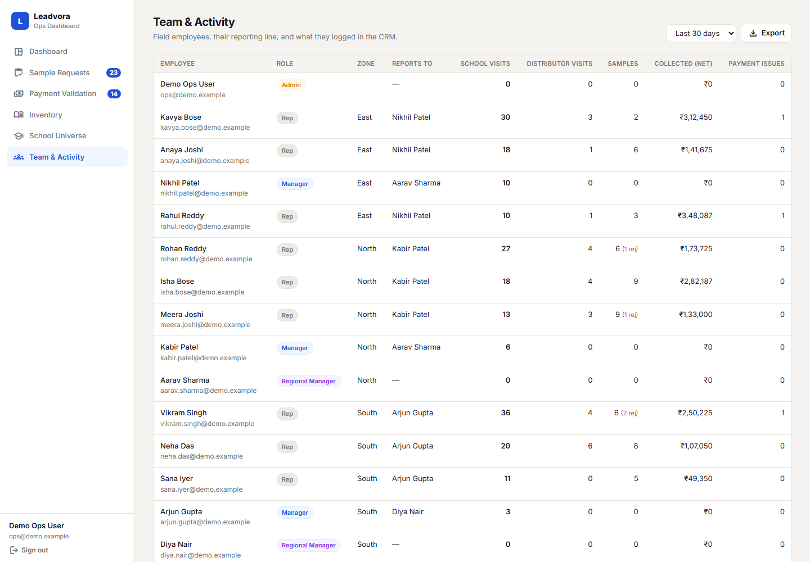

# Leadvora Ops Dashboard

> Back-office operations dashboard for a field sales CRM. It covers sample fulfilment, payment validation, inventory and team visibility.

🔒 **The source code is private.** This repository is a showcase only. Code walkthroughs are available on request.

<!-- Uncomment once a demo is live:
🎥 **Demo video:** https://youtu.be/your-video-id
🌐 **Live demo:** https://your-demo.vercel.app
-->



---

## The problem

Field reps logged school visits, sample requests and payments in a mobile CRM, but **nothing happened after that**:

- Once a regional manager approved a sample, there was no packing stage, no courier or AWB tracking, no delivery confirmation and no stock check.
- Payments were recorded but never checked against the bank, so a wrong UPI reference or a bounced cheque went unnoticed.
- Ops had no work queue and no view of turnaround time.

## The solution

A desktop back-office tool that takes over every sample request after RM approval and every payment recorded in the field.

> **Every approved sample has one visible stage and owner until delivery. Every field payment is validated or flagged. Nothing moves without a record.**

---

## Features

### 📦 Sample request pipeline
`Ops Queue → Processing → In Transit → Delivered` (plus RM Approval and Rejected)

- One queue per stage, with live counts in the sidebar
- Bulk actions: start processing, dispatch with courier + AWB, mark delivered, reject with a reason
- Expanded row view: school, rep, RM, line items with live stock, and the full timeline
- **Stock check**: shortages show in the list before dispatch and are blocked again in the database
- Excel dispatch template out and validated upload in. A file with any bad row is rejected whole
- Status emails queued automatically



### 💳 Payment validation
- Tabs: Pending / Validated / Wrong Entry / Cheque Issue
- Filter by payment mode, search by payment number or reference
- **Cheque aging**: cheques pending more than 3 days are flagged
- Receipts open through short-lived signed links (private storage)
- The rep is notified automatically when a payment is flagged



### 🗃️ Inventory
- Stock per title: on hand, committed (approved but not dispatched), free, with status flags
- Excel stock upload with a **before/after preview** before anything is saved



### 📊 Dashboard
- KPI cards, sample pipeline strip, **turnaround time per step against targets**
- School universe by stage, payment validation summary, low-stock alerts

### 🏫 School universe and 👥 team activity (read-only)
- Schools: search, stage and zone filters, owner, last visit, Excel export
- Team: reporting line plus visits, distributor visits, samples, collections and payment issues per person over 7/30/90 days

| Schools | Team |
|---|---|
|  |  |

---

## Tech stack

| Layer | Tech |
|---|---|
| Frontend | React 19, React Router 7, Vite 6 |
| Styling | Tailwind CSS 3 |
| Charts | Recharts |
| Excel import/export | SheetJS |
| Backend | Supabase (Postgres, Auth, Storage, Row-Level Security) |
| Hosting | Vercel |
| Tests | Node built-in test runner |

## Architecture and key decisions

- **Shared database, zero breakage.** The dashboard runs on the same Supabase project as the field CRM. Every schema change is additive (new columns and tables only, no enum changes), so the existing mobile app kept working untouched.
- **Stages are derived, never stored.** One stage map is the single source of truth for tabs, sidebar badges, counts and the dashboard, so they can't drift apart.
- **The browser never writes to tables.** Every ops action goes through a `security definer` Postgres RPC that checks the caller is an active admin and writes an audit event.
- **Defence in depth on stock.** Shortages are checked in the UI and checked again under a row lock in a Postgres trigger at dispatch, so stock can't go negative even with concurrent users.
- **Full audit trail.** Every action records who did it, when, and with what note.
- **Security.** RLS on every table, admin-only access gate, signed 5-minute links for payment receipts.
- **Excel-first ops.** Every bulk step has a template out and a validated upload in, all-or-nothing.

```
Field CRM (mobile)                       Ops Dashboard (this project)
  Rep raises sample ─► RM approves ─►  Ops Queue ─► Processing ─► Dispatched ─► Delivered
  Rep records payment ─────────────►  Pending ─► Validated / Wrong Entry / Cheque Issue
                         │                              │
                         └──────── Supabase (Postgres + RLS + RPCs + audit log) ───┘
```

## My role

<!-- Edit this to describe your own role -->
Designed and built the project end to end: product scope (MVP definition), database schema and migrations, security model (RLS + RPCs), and the full React frontend.

## Roadmap

- Email sender (Edge Function) and daily pendency digest
- Orders module (order form, invoice, dispatch), then returns and credit notes
- Read-only access for managers and RMs
- CI build and tests on every PR

---

📫 **Interested in the code or a live walkthrough?** Reach out through my GitHub profile.
